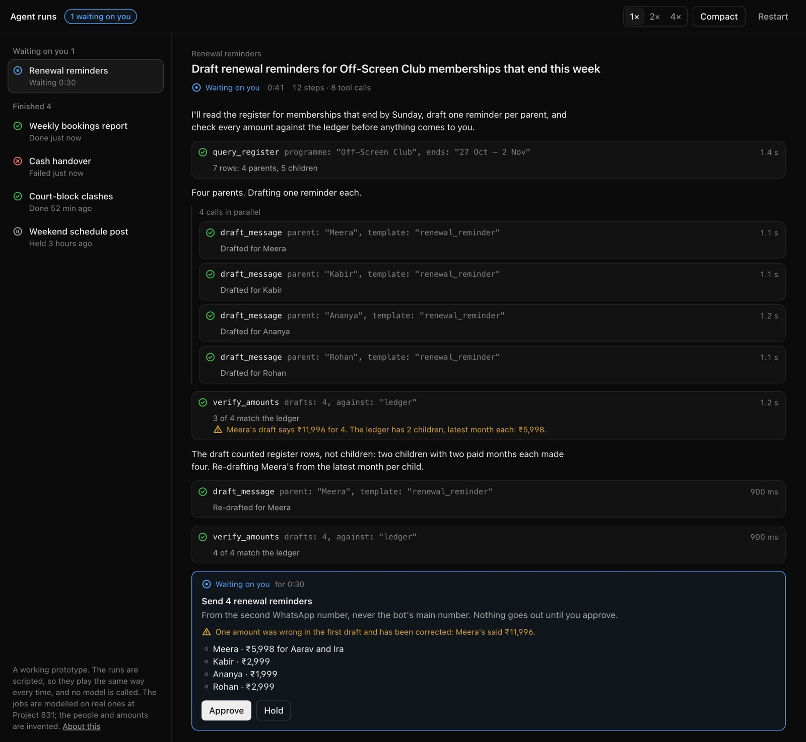

# Agent runs

The interface for long agent runs, as a working prototype: text streaming in, tool calls with their own state and timing, calls running in parallel, a rate limit retried with a countdown, a long step that says how far it has got, a stream that goes quiet and says it is still working, a failure that stops instead of guessing, and an outward step that waits for a person.

A finished run can be replayed event by event (`j` and `k`) and graded against a rubric. Each check points at the step where it was decided.



## How it is built

- **One list of events per run** (`src/run/types.ts`). The live view, the replay and the grade are all built from that list and nothing else, so what you review is exactly what you watched.
- **A pure reducer** (`src/run/reduce.ts`) folds events into steps. The replay is the same reducer over a prefix of the list.
- **A player** (`src/run/player.ts`) plays a script against a clock and stops at an approval until someone decides. Everything after the decision starts from that moment. A hold ends the run with nothing sent.
- **Checks** (`src/run/scripts.ts`) are functions over the event list, each returning pass or fail and the step that decided it.
- **The design system** is `src/ui/`: tokens (type, space, colour, status, motion, a compact density), a status mark that is always an icon and a word together, buttons, a meter.

The runs are scripted, so they play the same way every time, and no model is called. They are modelled on real jobs at Project 831, the sports venue I co-founded, where agents draft and a person decides. The people and amounts are invented. The wrong amount in the first run (₹11,996 for ₹5,998) is a real mistake from 17 Oct 2026, replayed with the check that now catches it.

A link can open a moment: `?run=renewals&t=40` is the renewal run 40 seconds in, waiting on you; add `&approve` to approve it and play on.

```bash
npm install
npm run dev
npm test        # 23 tests, including an axe pass, live and in review
npm run lint && npm run typecheck && npm run build
```

React 19 and TypeScript, no UI library. MIT.
